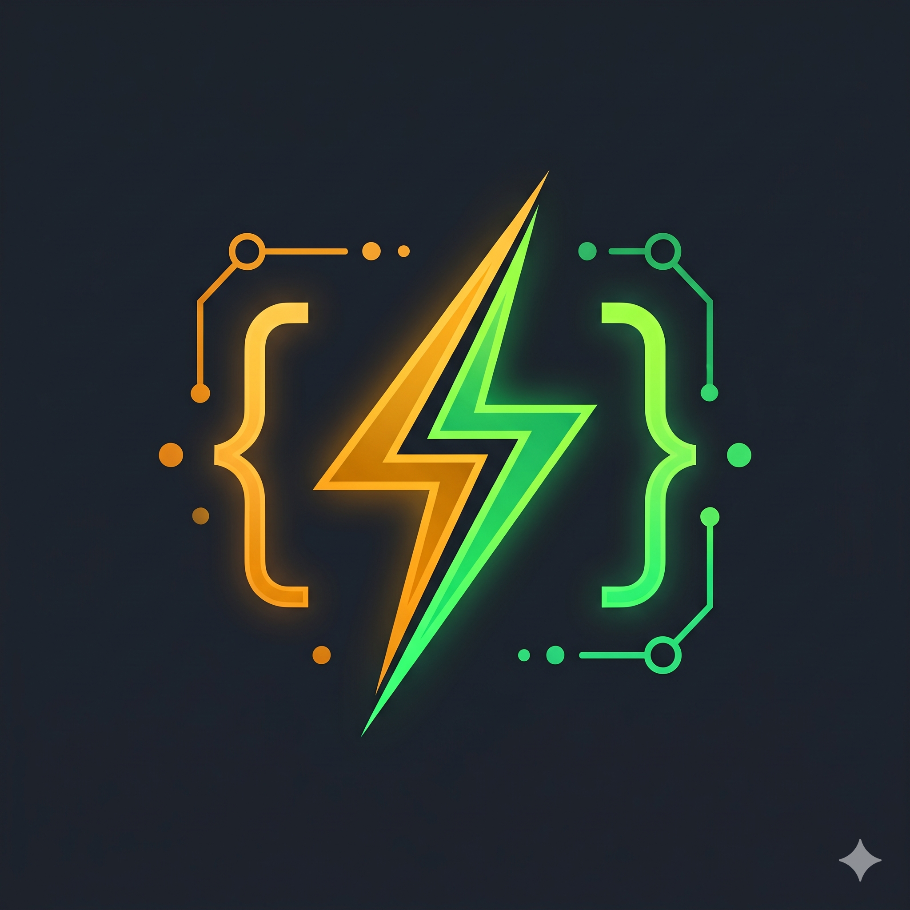
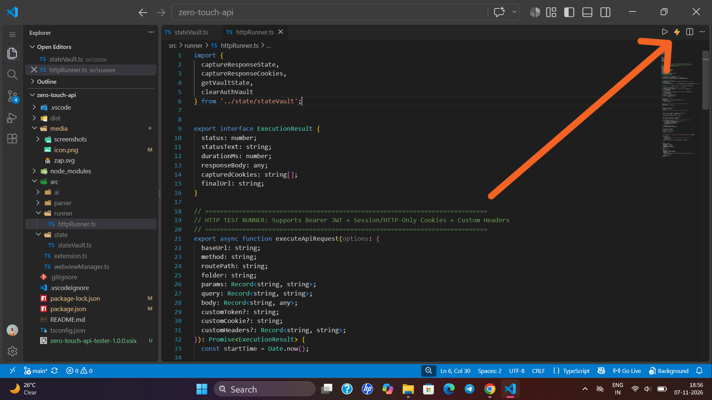
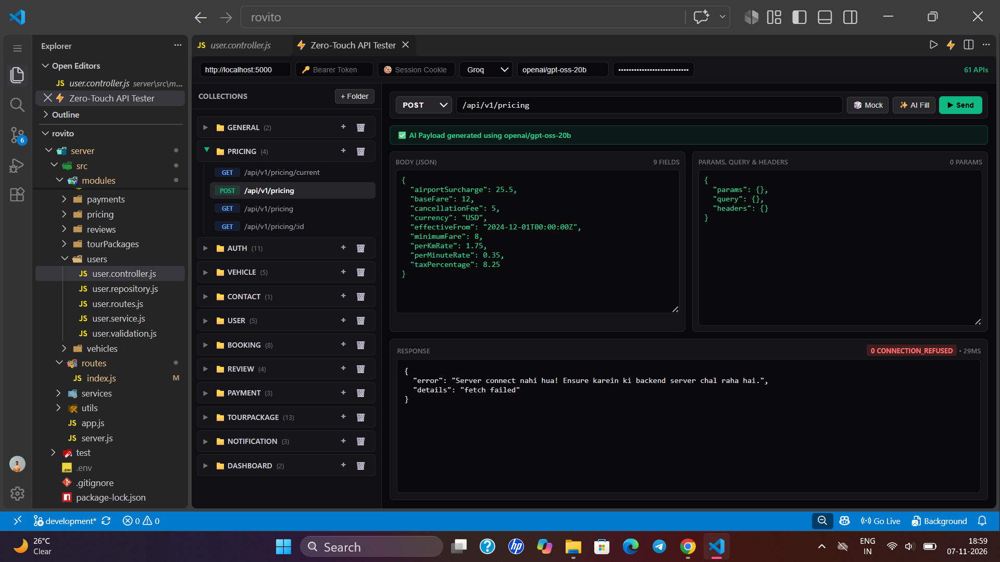
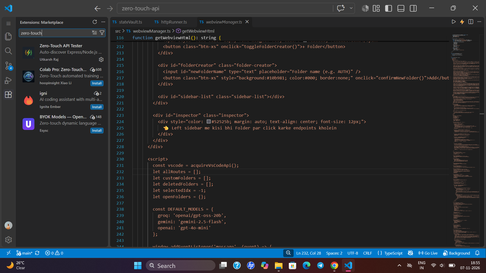

<div align="center">



# ⚡ Zero-Touch API Tester

**Auto-discover Express.js APIs via AST & Zod, generate smart Mock/AI payloads, and chain JWT/Cookies without leaving VS Code.**

[](https://marketplace.visualstudio.com/items?itemName=utkarshraj.zero-touch-api-tester)
[](https://marketplace.visualstudio.com/items?itemName=utkarshraj.zero-touch-api-tester)
[](https://marketplace.visualstudio.com/items?itemName=utkarshraj.zero-touch-api-tester)
[](https://github.com/Utkarshraj977/zero-touch-api)

<p align="center">
  <a href="#-why-zero-touch-api-tester">Why Zero-Touch?</a> •
  <a href="#-how-it-works-architecture">Architecture</a> •
  <a href="#-visual-tour--screenshots">Screenshots</a> •
  <a href="#-key-features-in-detail">Key Features</a> •
  <a href="#-quick-start">Quick Start</a> •
  <a href="#-author">Author</a>
</p>

</div>

---

## 🎯 Why Zero-Touch API Tester?

Traditional API testing forces you to switch windows to Postman, manually create collections, copy-paste route paths, inspect controller files to figure out what fields `req.body` expects, and manually copy JWT tokens after every login.

**Zero-Touch API Tester** reads your backend code directly and sets up your entire testing suite in **0 milliseconds**:

| Feature | Postman / Thunder Client | ⚡ Zero-Touch API Tester |
| :--- | :---: | :---: |
| **Route Discovery** | ❌ Manual typing | ✅ **Auto-scanned from Express AST** |
| **Mount Prefixes (`/api/v1`)** | ❌ Manual setup | ✅ **Auto-resolved from `app.use()`** |
| **Request Body Schema** | ❌ Write JSON by hand | ✅ **Extracted from Controllers, Zod, Joi & Models** |
| **Mock Data Generation** | ❌ Manual placeholders | ✅ **1-Click Faker (`🎲 Mock`) & LLM (`✨ AI Fill`)** |
| **Auth Token & Cookie Chaining** | ⚠️ Manual env scripts | ✅ **Auto-captured on Login & Wiped on Logout** |
| **Dependent Data (`email`, `id`)** | ❌ Copy-paste from responses | ✅ **Auto-injected into subsequent APIs** |

---

## 🧠 How It Works (Architecture)

Zero-Touch uses a **3-Pass Static AST Engine (`ts-morph`)** combined with a **Live State Vault** to keep your testing workflow completely automated:

```text
┌────────────────────────────────────────────────────────────────────────────┐
│                        1. 3-PASS AST WORKSPACE SCANNER                     │
├──────────────────────┬───────────────────────────┬─────────────────────────┤
│      Pass 1          │          Pass 2           │         Pass 3          │
│   app.ts / index.ts  │  Controllers & Validators │     Routes (*.routes)   │
│  Extracts `/api/v1`  │  Scans `req.body`, `Zod`, │  Links mount prefixes + │
│  & `app.use()` paths │  `Joi` & Mongoose Schemas │  handler symbols        │
└──────────┬───────────┴─────────────┬─────────────┴────────────┬────────────┘
           │                         │                          │
           ▼                         ▼                          ▼
┌────────────────────────────────────────────────────────────────────────────┐
│                      2. HYBRID PAYLOAD GENERATOR ENGINE                    │
│  • Tier 1 (0ms Instant): Context-aware `@faker-js/faker` (Mongo/SQL/UUID)  │
│  • Tier 2 (✨ AI Fill): Sends real Controller/Zod snippet to Groq/Gemini   │
└────────────────────────────────────┬───────────────────────────────────────┘
                                     │
                                     ▼
┌────────────────────────────────────────────────────────────────────────────┐
│                     3. AUTO-CHAINING STATE VAULT & RUNNER                  │
│  • Login / Register ──► Captures JWT Bearer + `Set-Cookie` + `email`/`id`  │
│  • Next API Click   ──► Auto-injects captured `id`, `email`, `workspaceId` │
│  • Logout Endpoint  ──► Automatically wipes Token & Cookie Jar from Vault  │
└────────────────────────────────────────────────────────────────────────────┘
```

---

## 📸 Visual Tour & Screenshots

### 1. One-Click Launch via the ⚡ Zap Icon
Open any Node.js / Express project and click the **⚡ (Glowing Bolt)** button in the top-right editor bar (or press `Ctrl + Alt + T` / `Cmd + Alt + T`):



### 2. Full Split-Pane Testing Workspace
Collapsible collection folders on the left, live JSON payload editors, AI configuration, and formatted response inspector on the right:



### 3. Available Directly in VS Code Extensions
Search **"Zero-Touch API Tester"** or **`utkarshraj`** in the VS Code Extensions tab:



---

## ✨ Key Features in Detail

### 🔍 1. Deep AST & Validator Resolution
* Automatically detects routes across standard `router.post('/login', ...)` and chained `router.route('/users').get(...).post(...)` patterns.
* Resolves destructured aliases (`const { firstName, phone } = req.body`) and Zod `safeParse` data bindings (`parsed.data.email`) while filtering out wrapper keys (`success`, `error`, `statusCode`).
* Automatically detects your database type (**MongoDB ObjectId**, **PostgreSQL/MySQL Integer**, or **UUID**) directly from `package.json`.

### 🎲 2. Dual-Engine Payload Generation (`🎲 Mock` + `✨ AI Fill`)
* **0ms Instant Mock:** Generates valid emails, passwords, 10-digit phone numbers, and IDs immediately on startup.
* **Multi-Platform AI Fill:** Supports **Groq**, **Google Gemini**, and **OpenAI** with a **customizable model input box** (e.g., `openai/gpt-oss-20b`, `llama-3.3-70b-versatile`, `gemini-2.5-flash`, `gpt-4o-mini`).
* **OS Keychain Security:** Your API key is encrypted globally using VS Code's native `SecretStorage` (Windows Credential Manager / macOS Keychain)—enter it once and use it across all your projects safely.

### 🔗 3. Smart Dependent Data & Auth Chaining
* **Zero-Config Auth:** Automatically extracts `token` / `accessToken` from login responses and parses `Set-Cookie` headers for HTTP-only cookie authentication.
* **Smart Logout Detection:** Hitting any `/logout` or `/signout` route (or clicking the `🧹` button) automatically purges stored tokens and expired cookies so protected routes can be tested accurately.
* **Live Context Linking:** Fields like `email`, `username`, `_id`, `channelId`, and `workspaceId` from previous requests are automatically remembered and injected into subsequent endpoints.

---

## 🚀 Quick Start

1. **Install** **Zero-Touch API Tester** from the VS Code Marketplace.
2. Open your Express / Node.js backend folder in VS Code.
3. Click the **⚡** icon in the top-right corner of the editor (or press **`Ctrl + Alt + T`** / **`Cmd + Alt + T`**).
4. Select any discovered endpoint from the **Collections** sidebar:
   * Click **🎲 Mock** to roll fresh Faker values.
   * *(Optional)* Paste your Groq/Gemini/OpenAI key in the top bar and click **✨ AI Fill**.
   * Click **▶ Send** to fire the request against your local or remote server!

---

## ❓ Frequently Asked Questions

<details>
<summary><b>Does it work with PostgreSQL, MySQL, Prisma, and Sequelize?</b></summary>
<br/>
Yes! The extension inspects your workspace <code>package.json</code> automatically. If it detects <code>pg</code>, <code>mysql2</code>, <code>prisma</code>, <code>sequelize</code>, <code>typeorm</code>, or <code>drizzle-orm</code>, it automatically generates SQL-compatible integer or UUID identifiers instead of MongoDB ObjectIds.
</details>

<details>
<summary><b>Is my AI API Key safe? Do I have to re-enter it in every project?</b></summary>
<br/>
Your API key is stored in your operating system's encrypted keychain via VS Code's <code>context.secrets</code> API. It is never written to workspace files or Git, and it persists globally across all projects you open.
</details>

<details>
<summary><b>Can I add custom routes or delete auto-discovered folders?</b></summary>
<br/>
Yes! Use the <b>+ Folder</b> button to create custom collections, the <b>+</b> icon on any folder to add manual endpoints, or the <b>🗑️</b> button to remove folders. All manual customizations persist in your workspace state.
</details>

---

## 👨‍💻 Author

<table>
  <tr>
    <td align="center" width="110">
      
    </td>
    <td>
      <h3>Utkarsh Raj</h3>
      <p><b>Full-Stack & Backend Software Engineer</b><br/>Building real-time systems, developer tools, and scalable cloud backends.</p>
      <p>
        <a href="[https://github.com/Utkarshraj977](https://github.com/Utkarshraj977)"></a>
        <a href="[https://utkarsh.website](https://utkarsh.website)"></a>
        <a href="mailto:utkarshraj72501@gmail.com"></a>
      </p>
    </td>
  </tr>
</table>

<div align="center">
  <sub>If Zero-Touch API Tester saves you time, please consider leaving a ⭐⭐⭐⭐⭐ review on the <a href="[https://marketplace.visualstudio.com/items?itemName=utkarshraj.zero-touch-api-tester](https://marketplace.visualstudio.com/items?itemName=utkarshraj.zero-touch-api-tester)">VS Code Marketplace</a>!</sub>
</div>